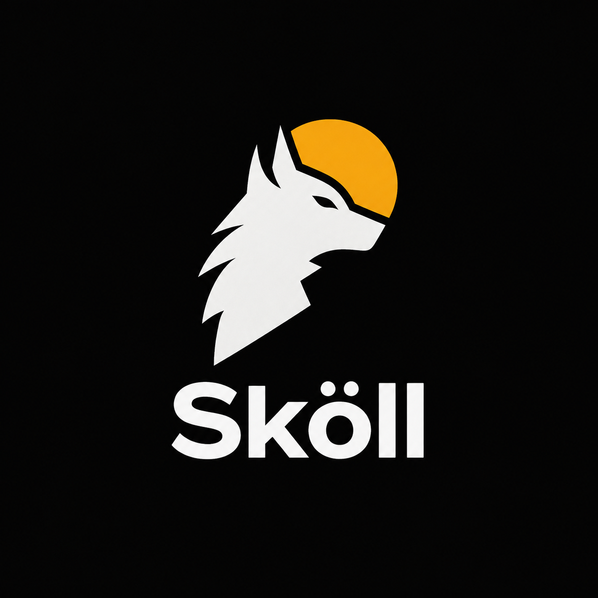
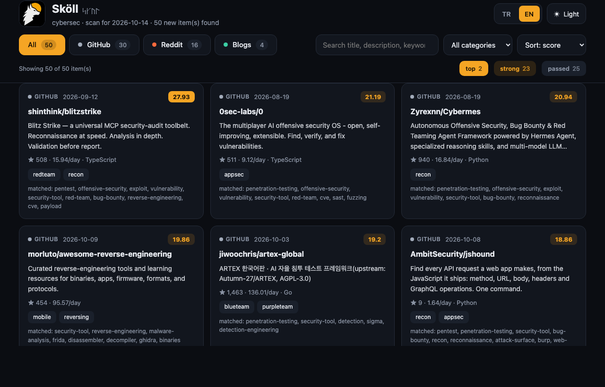
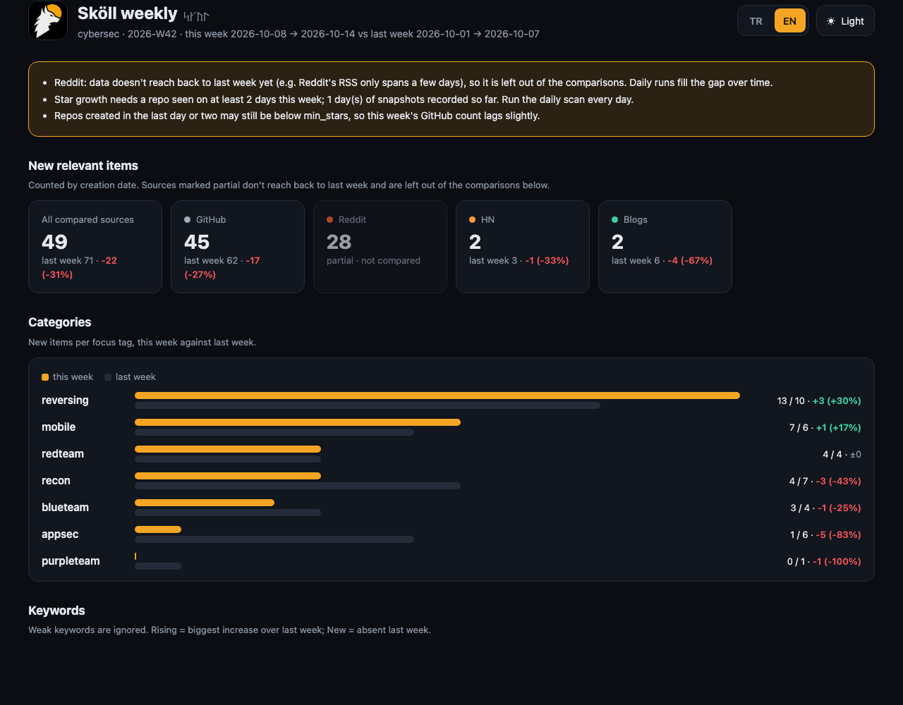

<p align="center">
  
</p>

<p align="center">
  <b>Daily, keyless discovery of new and rising security tools.</b><br>
  <i>In Norse myth, Sköll is the wolf that chases the sun across the sky.</i>
</p>

<p align="center">
  
  
  
</p>

---

Sköll scans **GitHub, Hacker News, Reddit and security research blogs** every
day, keeps what is relevant to offensive security, scores it by keyword
relevance and momentum, and writes a dated dashboard, a Markdown digest and a
ready-made analysis prompt for an LLM.

It is built for one job: **spotting a new tool in its first week or two**,
before everyone is talking about it.

- **No API keys.** Public APIs and RSS only. A free `GITHUB_TOKEN` is optional
  and only raises rate limits.
- **Deterministic core.** Fetching, dedup, scoring and filtering are plain
  Python rules: reproducible and tested. The LLM only interprets the result.
- **Topic-agnostic.** `cybersec` ships ready. A profile is just keywords and
  sources in YAML, so you can add `llm-tooling`, `devops` or anything else.



## Contents
- [Quick start](#quick-start)
- [Commands](#commands)
- [What you get](#what-you-get)
- [How scoring works](#how-scoring-works)
- [Sources and limits](#sources-and-limits)
- [Configuration](#configuration)
- [The LLM step](#the-llm-step)
- [Project layout](#project-layout)
- [Development](#development)
- [Responsible use](#responsible-use)

## Quick start

```bash
git clone https://github.com/Burakxep/skoll.git && cd skoll
pip install -r requirements.txt           # requests, feedparser, PyYAML
cp config.example.yaml config.yaml        # your personal copy (gitignored)

python -m skoll serve                     # web app: opens http://127.0.0.1:8765
```

In the web app press **Run** and the dashboard fills with the scan. Prefer the
terminal? `python -m skoll run --profile cybersec` does the same scan (about a
minute) and writes `reports/cybersec/<date>/report.html`.

Optional, for higher GitHub rate limits (a classic token with no scopes is enough):

```bash
export GITHUB_TOKEN=ghp_...
```

Run it once a day (cron, launchd, a scheduled CI job). Every run only shows
what is new since the previous days.

## Commands

| Command | What it does |
|---|---|
| `python -m skoll serve` | Local web app: dashboard with a **Run** button (`--port`, `--no-browser`) |
| `python -m skoll run -p cybersec` | Scan all sources, write today's reports |
| `python -m skoll run -p cybersec -f redteam` | Same, but only items tagged `redteam` |
| `python -m skoll run -p cybersec --dry-run` | Preview: no dedup, no history, writes `*.dry-run.*` |
| `python -m skoll check -p cybersec` | Test a profile's sources after editing the config |
| `python -m skoll weekly -p cybersec` | This week vs last week trend report |
| `python -m skoll weekly -p cybersec --no-fetch` | Same, offline, from recorded daily snapshots |
| `python -m skoll add-source -p cybersec --subreddit redteamsec` | Add a subreddit (also `--feed URL`, `--query "..."`) |
| `python -m skoll list-profiles` | List profiles and their sources |

`python -m skoll -h` and `python -m skoll <command> -h` show all options and examples.

## What you get

### Web app

```bash
python -m skoll serve            # http://127.0.0.1:8765
```

It serves the normal dashboard with one extra row: **profile, focus, dry run,
▶ Run** and **✨ Analysis prompt**. Run starts the same scan as `skoll run`,
shows its log, and reloads the page with the new report. The prompt button opens
`prompt.md` in a panel with copy and download. One scan at a time; the server
only listens on `127.0.0.1`. Reports opened straight from disk don't show the
Run row, since they have no server behind them.

### Daily reports

Each run writes a folder per day:

```
reports/cybersec/
├── 2026-10-14/
│   ├── report.html     dashboard
│   ├── digest.md       Markdown digest
│   └── prompt.md       analysis prompt for an LLM
├── latest.md           digest of the last real run
└── latest.prompt.md    prompt of the last real run
```

The **dashboard** is a single self-contained HTML file. It has:
- source tabs, a category menu, search, and sorting by score, date or stars/day;
- score colours you can click to filter;
- summary tiles (items, top, strong, breakouts, suspicious) and a source mix bar;
- an **Analysis prompt** button that opens the day's `prompt.md` (copy / download);
- light/dark themes and an **EN | TR** language switch.

Behaviour across runs:
- **Same-day re-runs** add the new finds to that day's report; they never shrink it.
- `--focus` runs write `report.<tag>.*` and dry runs write `*.dry-run.*`, so
  neither overwrites the day's main report.

### Weekly trends

```bash
python -m skoll weekly --profile cybersec
```

This compares the last 7 days with the 7 before. Output goes to
`reports/<profile>/weekly/<YYYY-Www>/`:
- **New relevant items per source, category and keyword**, counted by creation
  date. This works from the very first run, because the sources already cover
  about 14 days.
- **Rising and brand-new keywords.**
- **Fastest-growing repos**, measured from daily snapshots. This fills in as
  you keep running the daily scan.
- **Caveats on the page itself.** For example, Reddit's RSS only reaches back a
  few days, so it is shown but kept out of the comparison until daily
  snapshots cover last week.



## How scoring works

All relevance logic lives in [`skoll/scoring.py`](skoll/scoring.py). There is no LLM in this part.

1. **Relevance from keywords.** `include` keywords add points. Focus-tag
   keywords (`redteam`, `recon`, `mobile`, `appsec`, `reversing`, …) add points
   and tags. `exclude` keywords subtract points.
   - Matching is word-aware and forgiving: `red-team` also matches "red team",
     "red_team", "redteam" and plurals.
   - **Weak keywords** such as `reverse-engineering` only count next to another
     hit, so game mods don't sneak in.
2. **Momentum**: stars/day, total stars, HN points and comments. These are
   **log-scaled**, so a viral but off-topic repo can't outrank a dense on-topic match.
3. **Gates.** An item needs relevance of its own (`min_relevance`) and a score
   above its **source's** threshold. GitHub carries star momentum, so its
   threshold is higher: 10, against 4 for Reddit and blogs. Per-source quotas
   keep GitHub from crowding out everything else.
4. **Dedup.** An item is reported once. Items below the threshold are not
   remembered, so a slow starter can still surface later.
5. **Special tags**
   - **`breakout`**: an already-reported repo comes back when its stars
     explode. The default is +500 stars **and** 5× its stars on the day it was
     last reported.
   - **`suspicious`**: one author publishing several CVE exploit repos at once,
     a common pattern for fake PoCs that ship malware.
6. **Score colours** are relative to the source threshold: **top** ≥ 2.5×,
   **strong** ≥ 1.5×, otherwise **passed**. There is no fixed maximum score,
   and raw scores aren't comparable across sources.

Extra signals:
- Reddit posts must link a GitHub, GitLab or Codeberg repo. This drops Q&A threads.
- Any non-GitHub item linking a repo gets a bonus.
- Curated research blogs get a small bonus.

## Sources and limits

| Source | Access | Notes |
|---|---|---|
| GitHub | Search API | New repos are queried **week by week**, so 1-day-old repos aren't pushed out by older ones with more stars. Active repos up to `max_repo_age_days` (60) are also included. Keyless: 10 searches/min; the tool waits out the limit. |
| Hacker News | Algolia API | Last 14 days, minimum points configurable. |
| Reddit | Public RSS | Reddit blocks keyless `.json` (HTTP 403). All subreddits go in **one** multireddit request, since RSS allows about 1 request/min. RSS has no vote counts. |
| Blogs | RSS/Atom | Project Zero, PortSwigger, SpecterOps, Outflank, TrustedSec, watchTowr and more. |

A source that fails is skipped; it never crashes the run.

**Deliberately not used:**
- **X/Twitter**: its API is paid.
- **GitHub Trending**: not topic-specific, no API, and it scored zero relevant hits in testing.
- **GitLab**: almost no starred security projects.
- **star-history.com**: its data comes from the same GitHub API.

## Configuration

Copy `config.example.yaml` to `config.yaml`. Your copy is gitignored, so
personal sources and keywords stay local. The example is fully commented. The
knobs you are most likely to touch:

| Setting | Default | Meaning |
|---|---|---|
| `score_threshold` | github 10, hackernews 8, reddit 4, rss 4 | Minimum score per source |
| `max_per_source` / `max_items` | 30/10/20/10, 70 | Report size caps |
| `min_relevance` | 2.0 | Keyword relevance needed regardless of momentum |
| `score_tiers` | top 2.5, high 1.5 | Colour bands, as multiples of the source threshold |
| `breakout` | min_gain 500, ratio 5 | When a reported repo comes back |
| `require_repo_link` | `[reddit]` | Sources that must link a code repo |
| `weak_keywords` | `reverse-engineering` | Keywords that only count alongside others |
| `github.created_slice_days` | 7 | Query new repos in weekly slices |
| `github.max_repo_age_days` | 60 | Never include repos older than this |

To add a new topic, add a block under `profiles:` with its own `include`,
`focus_tags` and sources, then run `python -m skoll check -p <name>`.

## The LLM step

Sköll stops at structured candidates. The judgement is left to an LLM:
- **Any LLM:** paste `reports/<profile>/latest.prompt.md` into it. You get, per
  item, what it is, why it matters for offensive security, maturity and
  priority, then a top-3 shortlist.
- **[Claude Code](https://claude.com/claude-code):** the repo ships a
  `CLAUDE.md` that tells Claude to read the prompt after a run and answer it
  inline. No copy-paste and no API key.
- **Weekly:** `latest-weekly.prompt.md` asks for the week's trends and a watchlist.

## Project layout

```
skoll/
├── cli.py              command line (python -m skoll)
├── pipeline.py         fetch → dedup → score → report, daily snapshots
├── scoring.py          all relevance rules (keywords, momentum, tiers, breakout)
├── store.py            SQLite: reported items + daily snapshots
├── report.py           daily HTML / digest / prompt
├── server.py           local web app (python -m skoll serve)
├── weekly.py           weekly trend analysis
├── weekly_report.py    weekly HTML / digest / prompt
└── connectors/         github, hackernews, reddit, rss (one file per source)
templates/              dashboard, run bar + weekly HTML, theme, i18n (EN/TR), prompts
tests/                  offline unit tests (no network)
config.example.yaml     annotated config template
SPEC.md                 design decisions and their reasons
```

Local state is not committed (see `.gitignore`):
- `config.yaml`
- `data/skoll.db`, the SQLite history and snapshots
- `reports/`

## Development

```bash
python -m unittest          # offline, standard library only
```

Conventions:
- **No new runtime dependencies without a reason.** The runtime needs only
  `requests`, `feedparser` and `PyYAML`.
- **Relevance logic stays in `scoring.py`,** never in a prompt.
- **One connector per source,** returning `Item`s. A failing source must never
  crash a run.
- **UI text lives in `templates/i18n.json`** (EN + TR). `tests/test_i18n.py`
  fails if a key is missing in either language.

[`SPEC.md`](SPEC.md) explains why things are the way they are.

## Responsible use

Sköll surfaces offensive-security tooling for **research and authorized
testing**. Repos it lists are third-party code:
- Read the code before running anything.
- Treat items tagged `suspicious` with extra care: fake PoC repos are a known
  malware vector.
- Only use tools against systems you are allowed to test.

## License

[MIT](LICENSE)
